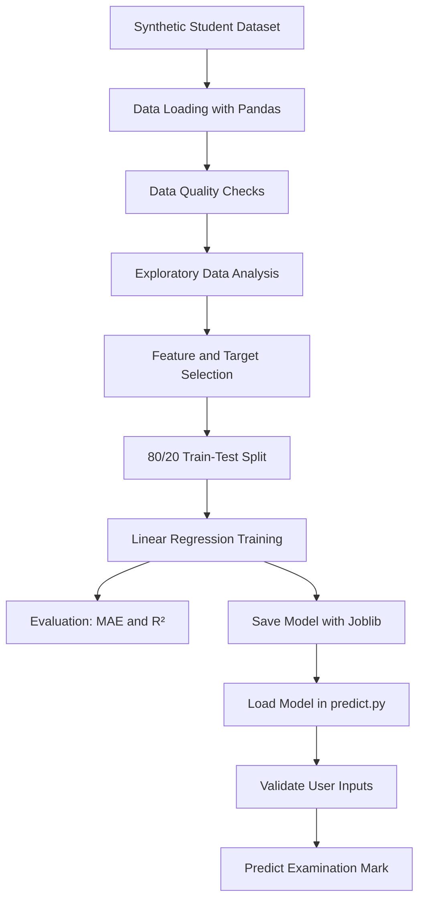

# 🎓 Student Performance Predictor

### Machine Learning-Based Academic Score Prediction Using Python

An educational machine learning project that predicts a student's examination score using **Linear Regression**, based on attendance percentage, previous examination marks and assignment marks.

The project demonstrates a foundational end-to-end machine learning workflow, from exploratory data analysis and preprocessing to model training, evaluation, prediction and model persistence.

**Project Type:** Supervised Machine Learning — Regression  
**Programming Language:** Python  
**Machine Learning Framework:** Scikit-learn  
**Dataset:** Synthetic student performance records  
**Interface:** Python command-line application  
**Status:** Functional educational prototype, with dataset path setup required

---

## 🚀 Project Highlights

- Developed a regression model for predicting student examination marks.
- Explored a synthetic dataset using Pandas.
- Inspected missing values, duplicate records and descriptive statistics.
- Visualised student mark distributions and relationships between variables.
- Used an 80/20 training and test split with a fixed random seed.
- Trained a Linear Regression model using Scikit-learn.
- Evaluated predictions using Mean Absolute Error (MAE) and R².
- Visualised actual versus predicted examination scores.
- Saved the trained model using Joblib for reuse.
- Created an interactive command-line prediction script with numeric input validation.

The project focuses on understanding core machine learning concepts and building a reproducible foundational regression workflow.

---

## 🎯 Problem Statement

Academic performance may be associated with factors such as attendance, previous examination results and assignment marks.

This project investigates whether a simple regression model can learn relationships between these variables and estimate a student's current examination mark.

### Project Objective

Build a machine learning system that:

1. Reads student performance data from a CSV file.
2. Explores and prepares the dataset.
3. Trains a regression model using historical input-output examples.
4. Evaluates predictions on held-out synthetic records.
5. Saves the trained model.
6. Allows users to enter new feature values and generate estimated marks.

**Important:** The project uses synthetic data. Its predictions are demonstrations of the machine learning workflow, not validated forecasts of real student performance.

---

## 🛠️ Technologies Used

| Technology | Purpose |
|---|---|
| Python | Core programming and application logic |
| Pandas | Data loading, exploration and manipulation |
| Matplotlib | Data visualisation |
| Scikit-learn | Regression training, splitting and evaluation |
| Joblib | Saving and loading the trained model |
| VS Code | Development environment |
| Git and GitHub | Version control and project documentation |

---

## 🗂️ Dataset

The project uses a synthetic dataset containing **500 student records** and four columns.

### Input Features

| Feature | Description |
|---|---|
| `attendance` | Student attendance percentage (0–100) |
| `previous_mark` | Previous examination mark (0–100) |
| `assignment_mark` | Assignment mark (0–100) |

### Target Variable

| Target | Description |
|---|---|
| `current_mark` | Examination mark to be predicted (0–100) |

### Example Dataset Format

```csv
attendance,previous_mark,current_mark,assignment_mark
90,44,57,61
64,47,33,42
84,41,48,45
```

These are example records from the included synthetic dataset.

### Why Synthetic Data?

Synthetic data allows experimentation with a supervised learning workflow without publishing real students' personal academic records.

However, the generated relationships may not reflect real educational outcomes.

Results from this dataset should not be interpreted as evidence that the system can accurately predict marks for actual students.

---

## 🏗️ System Architecture

The application uses a straightforward machine learning workflow.



### Workflow Explanation

**1. Data Loading**

Pandas reads the student performance dataset from a CSV file.

**2. Data Exploration**

The training script displays dataset dimensions, column information, descriptive statistics and sample records.

**3. Data Cleaning**

The script checks for missing values and duplicate records, then removes rows containing missing values or exact duplicates.

**4. Data Visualisation**

The project generates a mark-distribution histogram, a correlation matrix and a scatter-matrix visualisation.

**5. Model Training**

A Linear Regression model is trained using the selected features.

**6. Model Evaluation**

Predictions are compared with actual target values from a held-out test split.

**7. Model Persistence**

The trained model is saved as a `.pkl` file using Joblib.

**8. Prediction**

The command-line script loads the saved model, validates user input and produces an estimated examination mark.

---

## 🧠 Machine Learning Methodology

### Algorithm — Linear Regression

Linear Regression is a supervised machine learning algorithm used to predict continuous numeric values.

This project predicts a student's examination mark using three input features.

Conceptually, the model represents the prediction as:

\[
\hat{y} = b_0 + b_1x_1 + b_2x_2 + b_3x_3
\]

Where:

- \(\hat{y}\) = predicted current examination mark
- \(x_1\) = attendance percentage
- \(x_2\) = previous examination mark
- \(x_3\) = assignment mark
- \(b_0\) = intercept
- \(b_1, b_2, b_3\) = learned model coefficients

The coefficients are estimated during training.

### Why Linear Regression?

Linear Regression was selected as an interpretable baseline for learning regression fundamentals.

It is suitable for this educational experiment because it:

- Is relatively straightforward to implement and understand.
- Provides a simple model for continuous numeric prediction.
- Helps demonstrate how feature values contribute to a prediction.
- Enables evaluation using standard regression metrics.

It assumes an additive linear relationship between the input features and the target before prediction clipping.

More complex relationships may require alternative algorithms.

### Train-Test Split

The project uses:

| Dataset Portion | Percentage |
|---|---:|
| Training | 80% |
| Testing | 20% |

A fixed `random_state=42` is used to make the random split reproducible.

Training data is used to fit the model, while the held-out test data is used to evaluate its predictions.

---

## 📊 Model Evaluation

The model is evaluated using two regression metrics.

### 1. Mean Absolute Error (MAE)

MAE measures the average absolute difference between predicted and actual marks.

A lower MAE means that predictions are closer to the observed values on average.

### 2. R² Score

R² measures how well the model explains variation in the target relative to predicting a constant mean value.

Values closer to 1 generally indicate a better fit. R² can also be negative.

### Reproducing Evaluation Results

Run:

```powershell
.\.venv\Scripts\python.exe train_model.py
```

The script prints the actual MAE and R² values.

**No numerical evaluation results are claimed in this README until they have been reproduced and verified.**

### Actual vs Predicted Visualisation

The training script displays a scatter plot of actual examination marks against predicted marks.

Points closer to the diagonal reference line indicate smaller prediction errors.

These visualisations provide an introductory way to inspect model performance.

---

## 💻 Project Structure

The currently published repository contains:

```text
Student-Performance-Predictor/
│
├── train_model.py
├── predict.py
├── student_performance_data.csv
├── requirements.txt
└── README.md
```

Before training, move the dataset into a `data/` directory as described in the setup instructions.

After that change and successful training, the relevant files will be:

```text
Student-Performance-Predictor/
│
├── data/
│   └── student_performance_data.csv
│
├── models/
│   └── student_model.pkl
│
├── train_model.py
├── predict.py
├── requirements.txt
└── README.md
```

### File Responsibilities

| File | Purpose |
|---|---|
| `train_model.py` | Loads data, explores features, trains and evaluates Linear Regression, saves the model |
| `predict.py` | Loads the saved model and predicts a mark from three user inputs |
| `student_performance_data.csv` | Synthetic training and evaluation data |
| `requirements.txt` | Required Python libraries |
| `models/student_model.pkl` | Generated trained model artifact |

The `models/` directory is created automatically during training.

---

## ⚙️ Installation and Setup

### Prerequisites

- Python installed
- Git
- VS Code or another Python-compatible editor
- Windows PowerShell or a terminal

### Step 1 — Clone the Repository

```bash
git clone https://github.com/justlivingwith007-tech/Student-Performance-Predictor.git
cd Student-Performance-Predictor
```

### Step 2 — Create a Virtual Environment

```powershell
python -m venv .venv
```

### Step 3 — Install Dependencies

On Windows PowerShell:

```powershell
.\.venv\Scripts\python.exe -m pip install -r requirements.txt
```

### Step 4 — Correct the Dataset Location

The current training script expects the dataset at `data/student_performance_data.csv`, while the published CSV initially resides in the repository root.

Run these commands in Windows PowerShell from the repository root:

```powershell
New-Item -ItemType Directory -Force data
Move-Item student_performance_data.csv data/
```

This prepares the directory structure expected by `train_model.py`.

### Step 5 — Train and Evaluate the Model

```powershell
.\.venv\Scripts\python.exe train_model.py
```

The script performs exploratory data analysis, trains the regression model, prints evaluation metrics, displays Matplotlib figures and saves the model.

Close each displayed figure when necessary to allow the script to continue.

Expected generated model path:

```text
models/student_model.pkl
```

### Step 6 — Run the Prediction Program

```powershell
.\.venv\Scripts\python.exe predict.py
```

The program requests three inputs:

```text
Attendance percentage (0-100):
Previous mark (0-100):
Assignment mark (0-100):
```

It then displays an estimated examination mark.

**Note:** If the saved model has not been created, the prediction script exits with a missing-model message. Run `train_model.py` first. The existing message still mentions an older notebook filename; the actual training file is `train_model.py`.

---

## 🔍 Example Prediction

The training script includes the following illustrative feature values:

| Feature | Example Input |
|---|---:|
| Attendance | 85% |
| Previous mark | 70 |
| Assignment mark | 80 |

The model generates a predicted examination mark for these values.

The result depends on the coefficients learned during training. Run the script to obtain the actual output.

The prediction is clipped to the valid mark range of 0–100.

---

## ✅ Input Validation

The command-line prediction interface includes basic input validation.

It:

- Accepts numeric values.
- Rejects non-numeric text.
- Rejects numbers outside the 0–100 range.
- Repeats the input prompt until a valid number is entered.
- Limits the displayed prediction to the 0–100 range.

These checks improve the usability of the demonstration script, but they are not a substitute for comprehensive data validation or automated testing.

---

## 💡 Key Technical Concepts Demonstrated

This project provides practical experience with:

**Python Programming**

Using scripts, functions, imports, variables, exception handling and file paths.

**Data Analysis**

Loading CSV files, inspecting data, checking missing values and producing descriptive statistics.

**Machine Learning**

Separating features from targets, using train/test splits, training Linear Regression and generating predictions.

**Model Evaluation**

Using MAE, R² and actual-versus-predicted plots to inspect model results.

**Model Persistence**

Saving and loading trained machine learning models with Joblib.

**Basic Software Workflow**

Organising project files, managing dependencies and running a reproducible training script.

---

## ⚠️ Limitations

This project is a foundational educational prototype and has several limitations.

1. **Synthetic data:** The included records do not establish predictive performance on real student populations.
2. **Single algorithm:** Only Linear Regression is implemented; there is no comparison against alternative models.
3. **Limited evaluation:** The current workflow uses one train/test split without cross-validation or uncertainty estimation.
4. **Data cleaning:** Rows with missing values are removed rather than imputed. Data-cleaning decisions should be reviewed when working with real datasets.
5. **Restricted features:** Actual academic performance can depend on many factors not represented by the three input variables.
6. **No deployed application:** The current interface is a local command-line program, not a hosted web app or REST API.
7. **No automated test suite:** Automated unit, integration and continuous-integration tests have not yet been implemented.
8. **Prediction uncertainty:** The program provides a point estimate, not a confidence or prediction interval.

These limitations are important when interpreting results or considering future development.

---

## 🔒 Responsible Use and Data Privacy

The project is intended for education and experimentation.

- It should not be used to make consequential academic decisions about real students.
- Real student records should not be collected or published without appropriate permission and privacy protections.
- Model predictions should not be treated as guaranteed examination results.
- Predictions should be interpreted alongside relevant human judgement and educational context.
- Joblib model files should only be loaded from trusted sources.

---

## 🔮 Future Improvements

Planned enhancements include:

### Machine Learning

- Compare Linear Regression with Ridge Regression and Random Forest Regressor.
- Introduce cross-validation.
- Implement Scikit-learn preprocessing pipelines.
- Add RMSE and residual analysis.
- Investigate model generalisation and prediction uncertainty.

### Software Engineering

- Refactor training logic into reusable Python functions.
- Add Pytest unit tests.
- Implement automated checks using GitHub Actions.
- Improve error handling and logging.

### Application Development

- Build a FastAPI prediction endpoint.
- Develop a Streamlit interface.
- Add Docker support.
- Explore cloud deployment.

These improvements are planned, not currently implemented.

---

## 👨‍💻 About the Developer

**Aswin Balasubramanian**

MSc Artificial Intelligence student at the **University of Leicester, United Kingdom**.

I am developing practical skills in Python, machine learning, model evaluation and AI application engineering.

This project forms part of my learning journey toward building more sophisticated and reliable AI systems.

I am interested in **2027 UK AI Engineer and Machine Learning Engineer internships and industrial placements**.

**[GitHub](https://github.com/justlivingwith007-tech)** | **[LinkedIn](https://www.linkedin.com/in/aswin-balasubramanian-10b1aa321/)**

---

*An educational machine learning project focused on understanding regression, data preparation, evaluation and prediction workflows.*
